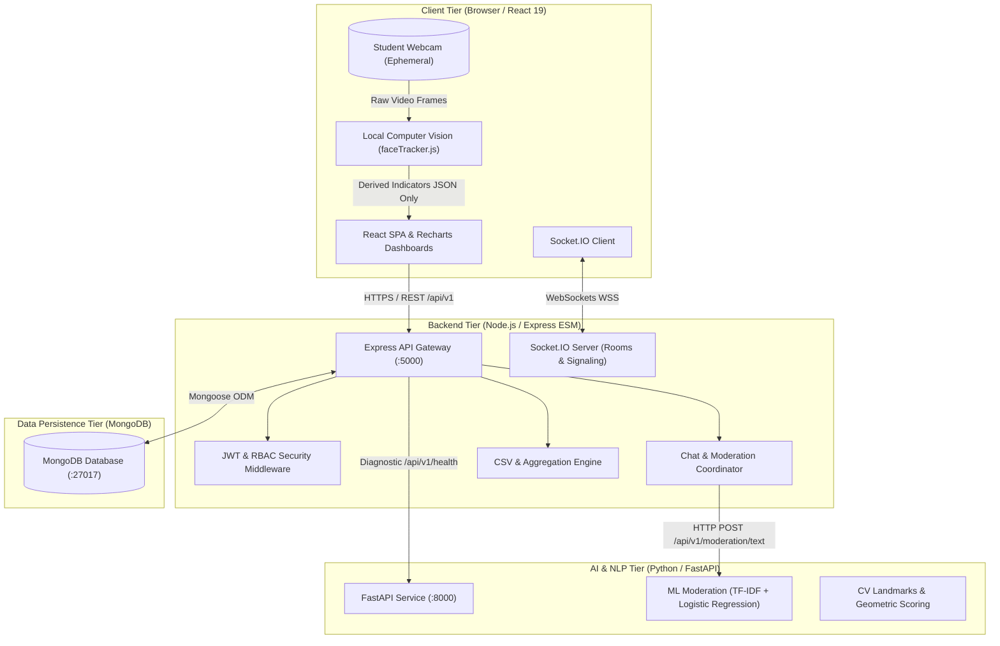
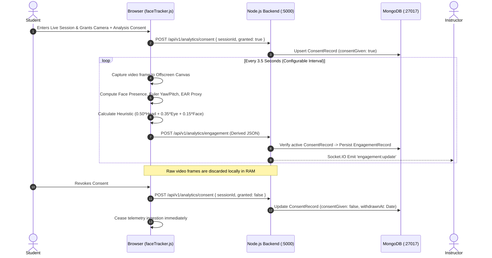
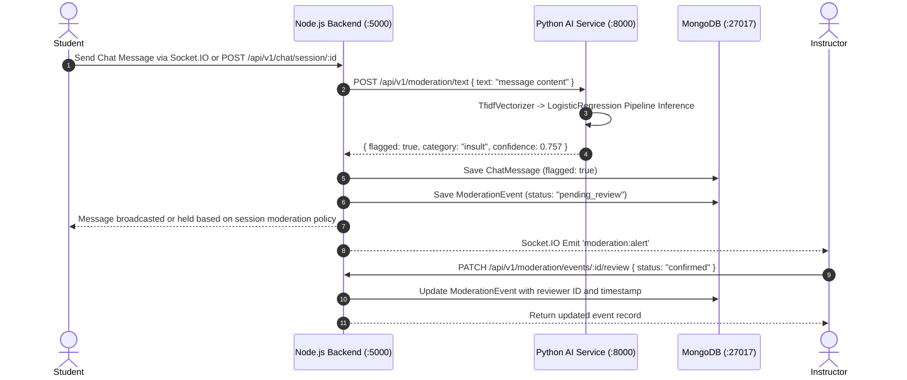

# System Architecture

## 1. Executive Overview

The **AI-Based Virtual Classroom Engagement Analytics System** is a distributed, academic-grade web platform designed to provide transparent, privacy-preserving classroom engagement telemetry, real-time communication, automated chat moderation, and administrative oversight for online learning environments.

The architecture emphasizes **edge-first client-side visual telemetry** to ensure that sensitive raw biometric video feeds never leave the student's personal device, combined with a decoupled **Python microservice for NLP moderation** and an authoritative **Node.js/Express backend** managing persistence, authentication, authorization, and real-time WebSocket distribution.

---

## 2. Component Topology

---

## 3. Tier Responsibilities and Boundaries

### 3.1 Client Tier (Frontend)
- **Technology:** React 19, Vite, Tailwind CSS, Lucide React, Recharts, Socket.IO Client.
- **Responsibilities:**
  - Role-tailored dashboards for Students, Instructors, and System Administrators.
  - Ephemeral camera acquisition via HTML5 `navigator.mediaDevices.getUserMedia`.
  - In-browser facial orientation, Euler angle derivation (yaw, pitch, roll proxy), Eye Aspect Ratio (EAR) approximation, and local scoring.
  - Strict privacy gating: Discards frames immediately after processing. Transmits only numeric JSON metrics (`overallScore`, `facialState`, `attentionScore`, `headPoseState`, `eyeGazeScore`).
  - Real-time room synchronization for chat, attendance notifications, and live engagement heatmaps.

### 3.2 Backend Application Tier
- **Technology:** Node.js (ES Modules), Express.js, Socket.IO, Mongoose, Helmet, Morgan.
- **Responsibilities:**
  - Authoritative source of identity, session lifecycle, and role permissions (Student, Instructor, Administrator).
  - Secure credential storage using `bcryptjs` (salt rounds: 12) and dual-channel JWT verification (HttpOnly cookies + `Bearer` token header).
  - Persistence of 10 structured schemas in MongoDB.
  - Real-time Socket.IO signaling rooms scoped to `session:${sessionId}`.
  - Forwarding student chat messages to the Python AI service for NLP classification prior to public classroom broadcast.
  - In-memory rate limiting for sensitive authentication and chat endpoints.

### 3.3 AI Microservice Tier
- **Technology:** Python 3.13, FastAPI, Uvicorn, Scikit-learn (`TfidfVectorizer`, `LogisticRegression`), OpenCV, NumPy.
- **Responsibilities:**
  - Standalone, stateless HTTP microservice operating on port `8000`.
  - Multi-class NLP moderation detecting `toxic`, `insult`, `threat`, `harassment`, and `profanity` with calibrated continuous confidence probabilities.
  - Algorithmic landmark geometry processing and normalized heuristic calculation.
  - Zero coupling with backend database: accepts JSON or images via documented REST contracts and returns structured inference outputs.

### 3.4 Data Persistence Tier
- **Technology:** MongoDB Local / Atlas Compatible.
- **Responsibilities:**
  - ACID-compliant document storage for user accounts, classes, enrollments, classroom sessions, attendance logs, consent audits, chat transcripts, moderation events, and engagement time-series.
  - Compound unique indexes preventing duplicate enrollments, simultaneous active attendance logs, and contradictory consent records.

---

## 4. Key End-to-End Workflows

### 4.1 Ephemeral Engagement Telemetry Pipeline

### 4.2 NLP Chat Moderation & Real-Time Review Pipeline

---

## 5. Security Architecture

1. **Defense in Depth:** All HTTP routes validate token authenticity and role privileges. Route access is denied at the server layer regardless of frontend interface state.
2. **Audit Logging:** Every critical administrative change, forbidden API access attempt, and authentication failure writes an immutable record to the `SecurityEvent` collection.
3. **Data Minimization:** No biometric face images, eye crops, audio streams, or raw browser screen recordings are persisted to disk or cloud storage.
4. **Transport Security:** CORS headers explicitly restrict origins to `http://localhost:5173`. Helmet applies strict HTTP response security headers.
