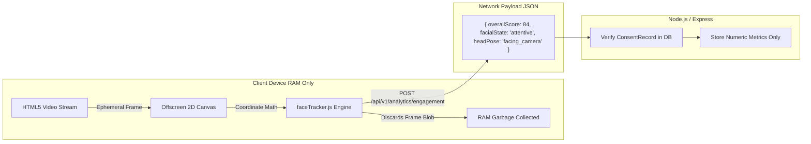
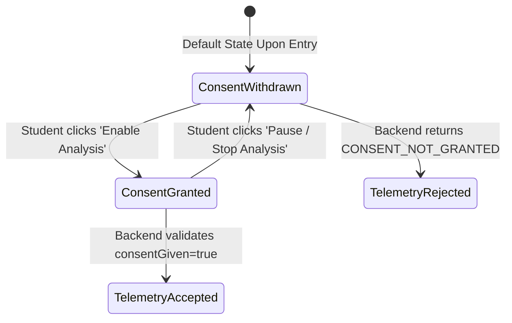

# Privacy & Security Architecture

## 1. Ethical Foundation & Privacy Philosophy

The **AI-Based Virtual Classroom Engagement Analytics System** is engineered around privacy-by-design principles. Automated visual monitoring in educational environments presents serious ethical risks regarding surveillance, student dignity, and unwarranted academic penalties.

To mitigate these risks, this platform establishes four foundational ethical tenets:

1. **Zero Video Persistence:** Raw webcam frames, video buffers, audio streams, and biometric facial imagery are **never uploaded, transmitted, or saved** to any remote server or persistent storage.
2. **Explicit, Granular Consent:** Participation in automated visual engagement telemetry is strictly opt-in. A student who chooses not to grant consent can still fully participate in the virtual classroom.
3. **Transparent, Observable Estimation:** Engagement indicators are explicitly treated as mathematical estimates derived from observable surface cues (head orientation, eye presence). They must **never** be interpreted as definitive proof of attentiveness, cognitive absorption, comprehension, or academic dishonesty.
4. **Non-Punitive Pedagogical Tooling:** Analytics exist solely to inform instructors about overall classroom pacing and aggregate participation patterns, not to automate disciplinary actions.

---

## 2. Client-Side Edge Computing & Telemetry Minimization

Traditional computer vision architectures stream client video frames over WebRTC or HTTP to cloud servers for server-side inference. This platform rejects that model in favor of **client-side edge derivation**:



### 2.1 The Ephemeral Frame Lifecycle
1. The student clicks "Enable Analysis" and grants browser camera permissions.
2. The browser captures a single video frame into an offscreen `HTMLCanvasElement` in volatile client RAM.
3. The geometric analyzer (`faceTracker.js`) computes:
   - Face presence indicator (`true` / `false`)
   - Euler orientation proxy (`yaw`, `pitch`, `roll`)
   - Eye Aspect Ratio (EAR) approximation
4. The canvas image data is immediately discarded. No disk I/O, canvas `.toDataURL()`, or frame serialization is ever invoked.
5. The extracted numerical vector is bundled into a lightweight JSON payload and transmitted over HTTPS to the backend.

---

## 3. Explicit Student Consent Lifecycle

Consent is managed via dedicated `ConsentRecord` documents in MongoDB:



### 3.1 Server-Side Enforcement Guarantee
Even if a modified client attempts to submit engagement telemetry via HTTP POST, the backend controller (`backend/src/controllers/analyticsController.js`) enforces:

```javascript
const consent = await ConsentRecord.findOne({
  studentId,
  sessionId,
  analysisType: 'face_landmarks',
});

if (!consent || !consent.consentGiven) {
  return res.status(200).json({
    success: false,
    message: 'Metrics discarded: Student has not consented to engagement analytics',
    code: 'CONSENT_NOT_GRANTED',
  });
}
```

---

## 4. Addressing Context & Limitations of Engagement Metrics

Instructors and administrative reviewers must interpret engagement telemetry within the context of normal human behavior:

| Observable Cue | Misleading Interpretation | Genuine Contextual Cause |
|---|---|---|
| **Head pitched downward** | "Student is asleep or ignoring the lecture." | Student is taking handwritten notes in a physical notebook. |
| **Gaze directed sideways** | "Student is distracted or cheating on an exam." | Student is working on a dual-monitor setup or referencing lecture slides. |
| **Temporary face absence** | "Student has abandoned the classroom." | Camera field-of-view adjustment, poor lighting, or brief physical movement. |
| **Lower blink / ear variance** | "Student is lethargic or unresponsive." | Eye wear (glasses), screen glare, or personal ocular physiology. |

---

## 5. Security Architecture & Controls

### 5.1 Authentication & Authorization
- **Password Protection:** Stored as cryptographic hashes generated with `bcryptjs` using 12 salt rounds.
- **Dual-Mode JWT:** Supported via HttpOnly cookies (mitigating XSS token theft) and standard `Bearer` authorization headers (for programmatic integration).
- **Role-Based Access Control (RBAC):** Middleware checks `req.user.role` on every protected endpoint. Route access is denied at the server layer regardless of UI state.

### 5.2 Defensive Headers & Network Hardening
- **Helmet Middleware:** Enforces `Content-Security-Policy`, `X-DNS-Prefetch-Control`, `X-Frame-Options: SAMEORIGIN`, and `Strict-Transport-Security`.
- **CORS Configuration:** Origin whitelist strictly limited to authorized client URLs (e.g. `http://localhost:5173`).
- **Rate Limiting:** Protects sensitive endpoints (e.g., `POST /auth/login`, `POST /chat`) against brute-force attacks and socket flood denial-of-service.

### 5.3 Immutable Security Audit Log
All security-relevant occurrences write to the `SecurityEvent` collection:
- `login_failure`: Tracks invalid credentials with IP address and user-agent.
- `forbidden_access`: Triggers when a student attempts to invoke instructor or administrative endpoints.
- `unauthorized_join`: Triggers when an unenrolled user attempts to join a private lecture room.
